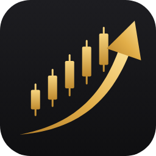
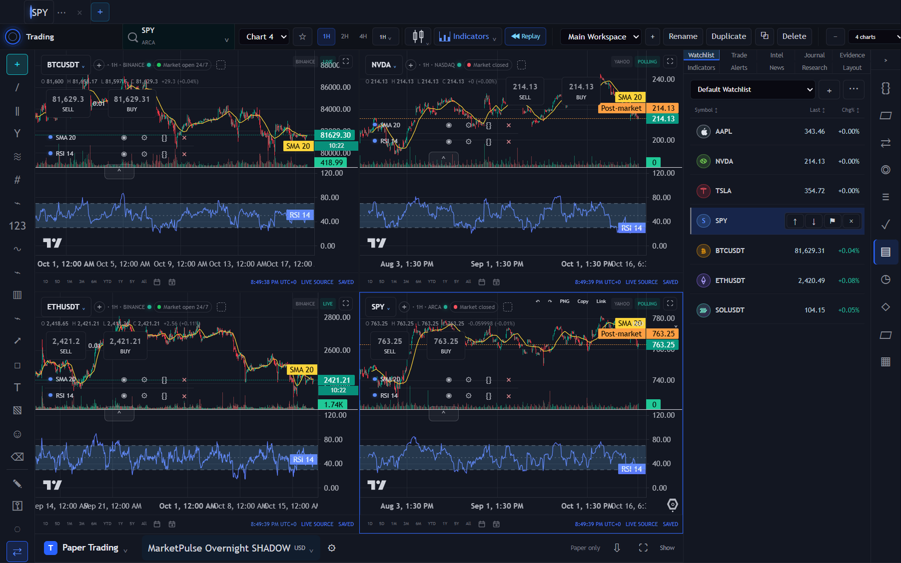
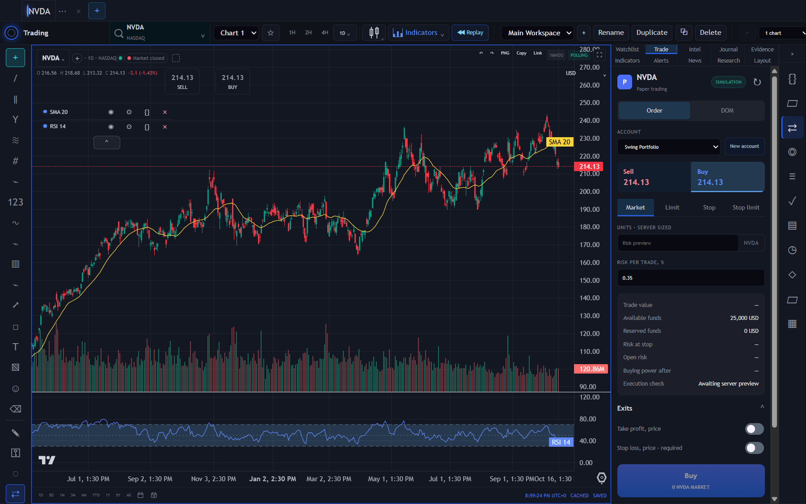
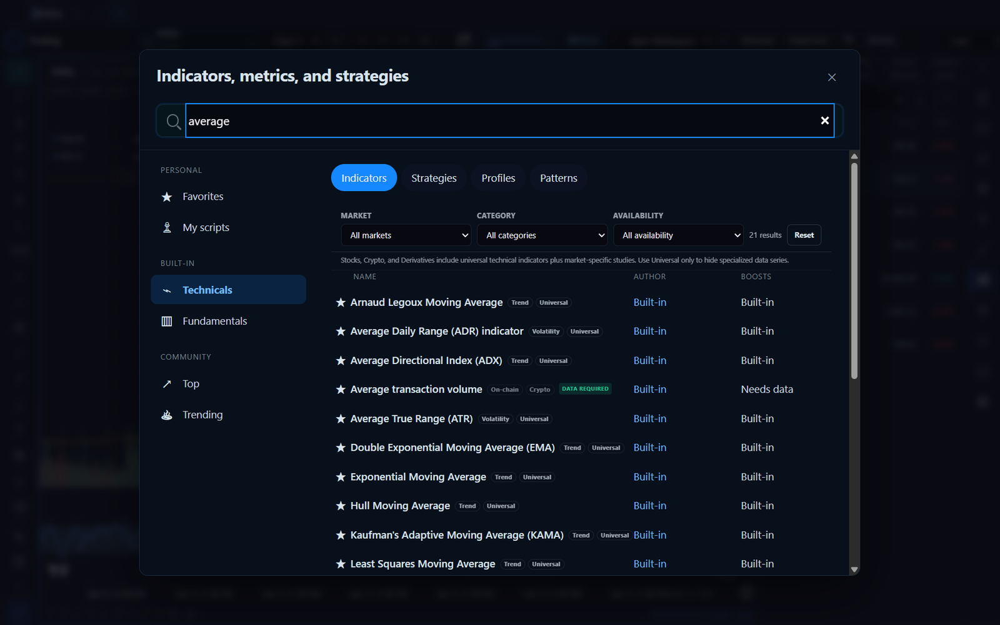
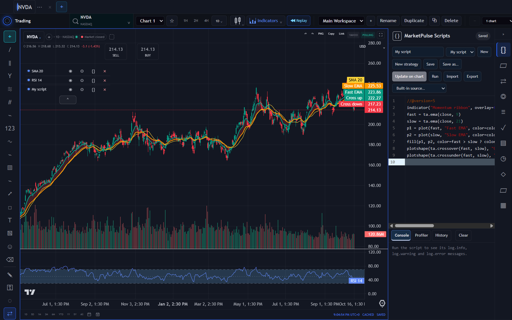
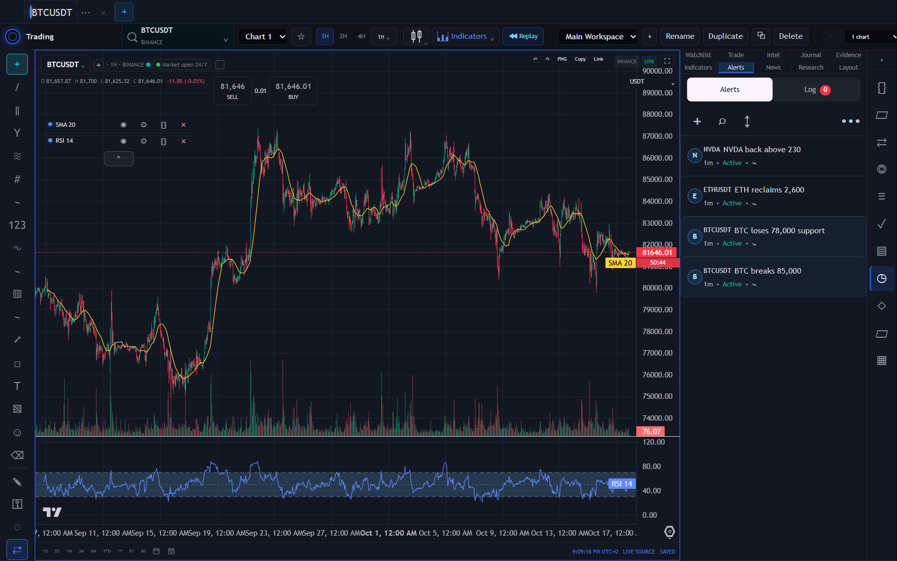
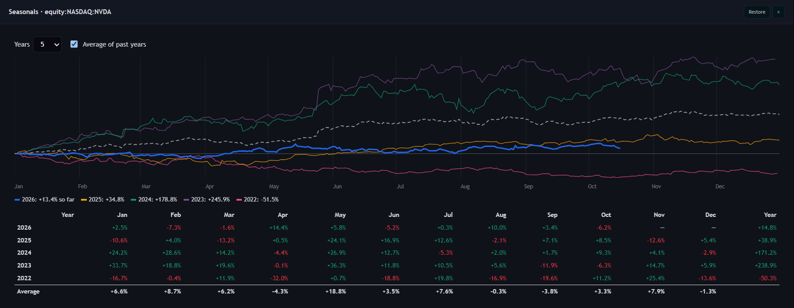
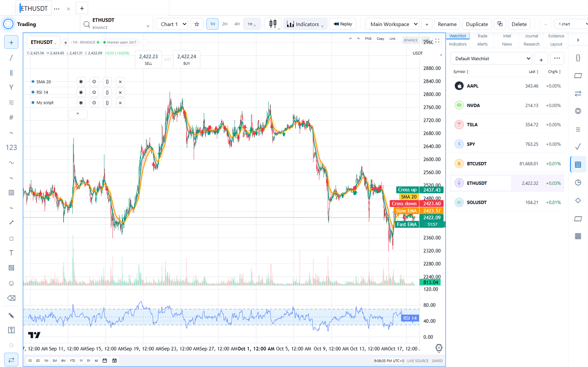

  

<h1 align="center">MarketPulse</h1>

  <strong>Built for real-time market monitoring, premarket gappers, breaking catalysts, and momentum signals.</strong>

  Professional charts, alerts, paper trading and your own indicators in one desktop app. 
  Free, open source, and it runs entirely on your computer.

  <a href="https://github.com/autonomx/MarketPulse/releases/latest"><strong>⬇&nbsp; Download for Windows</strong></a>
  &nbsp;·&nbsp; macOS in testing

  

---

## Your whole market on one screen

Watch Bitcoin tick while Nvidia sets up for the open. MarketPulse puts up to **14 charts** in one layout, each with
its own symbol, timeframe and indicators, next to a live watchlist.

- **Live data, no sign-up.** Crypto streams from Binance, with Coinbase and Kraken also built in. US stocks come
  free through Yahoo Finance. Connect your Alpaca or Interactive Brokers account for their market data.
- **Every timeframe you need.** One-minute bars to monthly candles, plus quick ranges from one day to all history.
- **Pro drawing tools.** Trend lines, channels, pitchforks, Fibonacci, Gann, Elliott waves, patterns, notes and more.
- **Workspaces that remember.** Save layouts, switch between chart sessions in the title bar, and open a workspace in
  its own window on a second monitor.
- **Bar replay.** Step back in time and replay the chart bar by bar to practise reading price action.

## Practise trading without risking a cent

  

Every install comes with **paper trading**. Open as many simulated accounts as you like and trade straight from the
chart:

- Market, limit, stop and stop-limit orders, with a depth-of-market view.
- Position sizing from the risk you choose per trade, with take-profit and stop-loss exits.
- Positions, order history, and an automatic journal of every trade with your wins and losses.

## 200+ built-in indicators, and your own

  

Moving averages of every kind, RSI, MACD, ATR, ADX, volume and breadth studies: search more than 200 built-in
indicators, metrics and strategies by name, market or category, and add them in one click.

When the built-ins aren't enough, write your own with **MarketPulse Scripts**:

  

- Familiar building blocks: `indicator()`, `plot()`, `fill()`, `ta.ema()`, `ta.crossover()` and many more.
- A live console, a profiler and version history for every script.
- Turn a script into a strategy or an alert.

## Never miss the move

  

Set alerts on price levels, on the trend lines you draw, on whole watchlists, or from your own scripts. MarketPulse
keeps watching from the system tray after you close the window. It shows a desktop notification and badges its
taskbar icon until you look. Add your mail server and it emails you too.

## Research that goes deeper

  

- **Seasonals:** how a symbol has behaved through the year, month by month, over the past five years.
- **Company financials:** income statement, balance sheet, cash flow and key ratios for US stocks, straight from
  their SEC filings, with earnings dates, dividends and splits on the chart.
- **AI research (optional):** connect your own AI provider, such as OpenRouter, Cerebras or a local model through
  LM Studio or llama.cpp, and ask for a read-only analysis of the chart's structure, key levels and risks.
  It never places orders.
- **Market scanner, replay and backtesting,** and an economic calendar with a free FRED key.

## Light or dark, your call

  

## Your data stays yours

- **Runs on your computer.** MarketPulse brings its own database. There is no cloud account, no subscription and no
  telemetry. Market data comes straight from the providers you choose. The one thing that leaves with it: the SEC
  asks every request for company filings to include a contact email, so MarketPulse sends your account's email to
  the SEC, and nowhere else.
- **Protected.** Sign in with a password, and invite others or allow guests on a shared computer. API keys are
  encrypted with Windows' own data protection.
- **Backed up.** A copy of your data is taken every day, and the last seven are kept.
- **Free and open source,** under the MIT licence.

## Get MarketPulse

1. Download **MarketPulse-Setup-x.y.z.exe** from the [latest release](https://github.com/autonomx/MarketPulse/releases/latest).
2. Run it. It installs just for you, with no administrator rights needed (about 600 MB).
3. MarketPulse sets itself up on first launch, in about 30 seconds. Then create your password and start charting.

Updates install themselves the next time you quit.

> **Windows says it "protected your PC"?** MarketPulse isn't code-signed yet, so SmartScreen doesn't recognise it.
> Choose **More info**, then **Run anyway**.

**Requirements:** Windows 10 or 11 (64-bit). A macOS version for Apple silicon is in testing. It will be released
once it is signed and notarized by Apple.

## Questions

**Is it really free?** Yes. MarketPulse is open source under the MIT licence: no trial, no subscription.

**Do I need a broker account?** No. Charts, alerts and paper trading work out of the box with free data. A broker
account (Alpaca or Interactive Brokers) is optional, for their market data.

**Does it trade with real money?** No. MarketPulse is for watching markets, research and paper trading.

**Where is my data?** In `%LOCALAPPDATA%\MarketPulse` on your computer. Uninstalling keeps it unless you choose to
remove it.

---

MarketPulse is a research and paper-trading tool, not investment advice. Market data is provided by third
parties under their own terms. For developers: [build, test and architecture](docs/DEVELOPMENT.md) ·
[macOS build](docs/MACOS.md) · [roadmap](docs/ROADMAP.md). Licensed under MIT; bundled software is listed in [NOTICE](NOTICE) and
[THIRD_PARTY_NOTICES.md](THIRD_PARTY_NOTICES.md).
